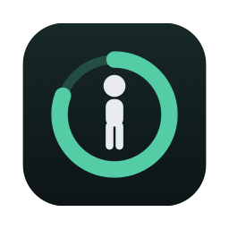
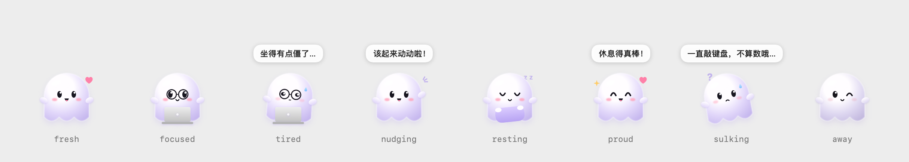

<div align="center">



# 久坐工具提醒 · sitless

**一个只在你真的起身时才算数的 macOS 久坐提醒。**

[](https://github.com/584144/sitless/actions/workflows/ci.yml)
[](#build)
[](LICENSE)

macOS 14+ · Apple Silicon / Intel · 开源免费

</div>

> 本项目是 [sitless](https://github.com/584144/sitless)，fork 自 Mohamed Elshesheny 的 [sigstop](https://github.com/Mohamed-Elshesheny/sigstop)（GPL-3.0）。原作者的版权和许可证保留在 [LICENSE](LICENSE) 与 [NOTICE](NOTICE) 中。按照原项目的 [商标说明](https://github.com/Mohamed-Elshesheny/sigstop/blob/main/TRADEMARK.md)，本 fork 换了名字、bundle id、图标和菜单栏标记，**它不是官方 sigstop**。

## 它和普通计时器有什么不同

普通计时器只会到点响一下，你看到了、点掉了，它就当你休息过了。可是"看到了"不代表"做了"，这样的记录没有参考价值。

久坐工具提醒只认你**真的离开了键盘**：

- ⏱️ **只算真正的工作时间**：按键盘鼠标的活跃度计时，离开的时间不算进去。默认连续工作 45 分钟提醒一次，可以在设置里改。
- 🚶 **休息期间敲键盘就不算**：本 fork 新增的规则。休息倒计时期间，如果键盘鼠标累计活跃超过 **1 分钟**，这次休息作废：工作计时不清零，提醒很快会再来，当天统计里算"放弃的休息"。
- 🤫 **不打断你**：开会（麦克风或摄像头在用）、全屏、专注模式下会等一等，挑一个停顿的时机再提醒。
- 📊 **看得见的一天**：活跃时长、最长连续工作、休息次数，以及真正做到的有几次。
- 🇨🇳 **中文界面**：菜单栏、设置、提醒弹窗、休息页都是中文，提醒语是一套温和语气的中文文案。系统语言是中文时默认显示中文，也可以在设置 → 节奏 → 界面语言里切换中文 / English。
- 🔒 **数据不出本机**：不需要任何权限，不联网（只有你手动点"检查更新"时才会发一次请求），不读取窗口内容、按键内容和剪贴板。

## 桌面宠物



一只软糯的小幽灵浮在桌面上，表情跟着你坐了多久变化：

| 状态 | 什么时候 |
|---|---|
| 开心漂浮 | 刚开始工作 |
| 戴眼镜敲电脑 | 工作中 |
| 累了、冒汗 | 快到提醒时间 |
| 蹦跳挥手："该起来动动啦！" | 该休息了 |
| 抱着枕头睡觉 | 休息中 |
| 转圈、爱心 | 刚完成一次算数的休息 |
| 歪头、问号 | 休息期间一直敲键盘，这次不算 |
| 眨眼等你 | 你离开了或暂停了 |

可以拖到任何位置（会记住位置）。鼠标靠近时它会歪头看你；单击转一圈，并显示今天坐了多久、休息了几次；双击开始休息；右键可以隐藏。它不抢焦点，也不会出现在录屏和屏幕共享里。可以在设置或菜单栏里开关。

App 默认不在程序坞显示，只在菜单栏和桌面宠物上，关掉窗口也不会退出。要退出请用菜单栏面板里的"退出"。

## 设置

设置在菜单栏图标 → Settings。也可以直接编辑配置文件：

```
~/Library/Application Support/io.github.584144.sitless/settings.json
```

```json
{
  "workIntervalMinutes": 50,
  "breakDurationMinutes": 5,
  "maxActiveDuringBreakSeconds": 60,
  "language": "zh-Hans"
}
```

| 键 | 含义 | 默认 |
|---|---|---|
| `workIntervalMinutes` | 连续工作多少分钟后提醒 | 45 |
| `breakDurationMinutes` | 一次休息多少分钟 | 5 |
| `language` | 界面语言：`system`（跟随系统）、`zh-Hans`、`en` | system |
| `maxActiveDuringBreakSeconds` | 休息期间键盘鼠标最多可以用多少秒，超过就不算休息（10–600） | 60 |

改完退出再打开 App 就会生效。用 `--doctor` 可以看到当前生效的值：

```sh
/Applications/sitless.app/Contents/MacOS/sitless --doctor
```

<a id="build"></a>

## 从源码构建

装好 Command Line Tools 就够了，不需要 Xcode。

```sh
git clone https://github.com/584144/sitless
cd sitless/app
make bundle  # 生成 dist/sitless.app，在你本机签名
make run     # 构建并启动
make test    # 跑测试，不需要图形界面
make verify  # 对构建出的 App 检查网络和隐私方面的承诺
```

把 `dist/sitless.app` 拖进"应用程序"就能长期使用。自己构建的 App 没有隔离属性，打开时不会被 macOS 拦下。

实现细节在 [`docs/`](docs)（英文，来自上游项目，已按本 fork 更新）。休息判定见 [BREAK-DECISION.md](docs/BREAK-DECISION.md)，本机存储了哪些数据见 [PRIVACY.md](docs/PRIVACY.md)。

## 发布与自动更新

本 fork 目前还没有发布安装包，也没有启用自动更新。`Info.plist` 里的 `SUPublicEDKey` 仍是上游的公钥。如果你要发布自己的版本，请先用 Sparkle 的 `generate_keys` 生成自己的密钥并替换它，再参考上游的发版文档操作。

## 相对 sigstop 的改动

- 新增：休息期间键盘鼠标累计活跃超过上限（默认 60 秒）时，这次休息不算数。日志的 `break_end` 行新增 `active_s` 和 `void` 字段。
- 改名为"久坐工具提醒 / sitless"，换了 bundle id、模块名、图标、菜单栏标记和配色。
- 新增桌面宠物（软糯小幽灵），表情跟随工作状态。
- 默认不在程序坞显示。
- 新增中文界面和一套温和的中文提醒语，可在设置里切换语言。
- 清空了上游的更新源。

## 许可证

[GPL-3.0](LICENSE)。原作者 Mohamed Elshesheny 的版权声明见 [NOTICE](NOTICE)。
