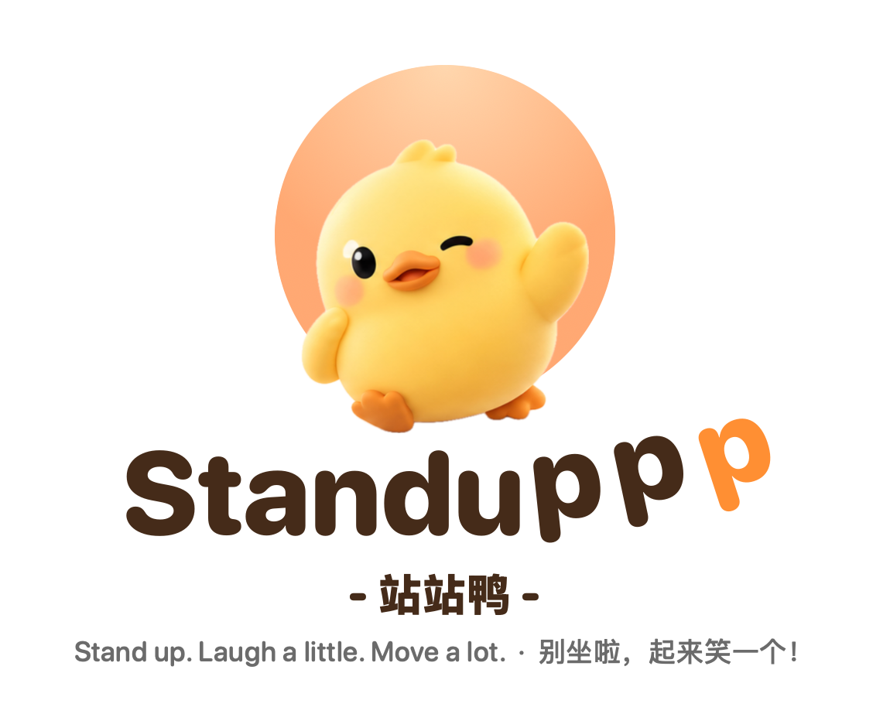
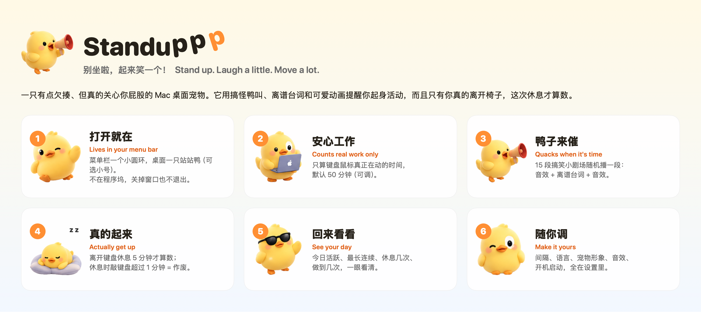

<div align="center">

<picture>
  <source media="(prefers-color-scheme: dark)" srcset="docs/images/logo-dark.png">
  
</picture>

**别坐啦，起来笑一个！**　·　*Stand up. Laugh a little. Move a lot.*

[](https://github.com/584144/standuppp/actions/workflows/ci.yml)
[](#build)
[](LICENSE)

macOS 14+ · Apple Silicon / Intel · 开源免费

</div>

**Standuppp（站站鸭）** 是一款有点欠揍、但真的关心你屁股的 Mac 桌面宠物。它会用搞怪鸭叫、离谱台词和可爱动画提醒你起身活动，让久坐提醒不再是一条无聊的系统通知。



## 特点

- 🦆 **桌面小黄鸭**：浮在桌面上，表情跟着你坐了多久变化；可拖动，单击看今天的数据，双击开始休息。
- ⏱️ **只算真的在工作**：按键盘鼠标的活跃时间计时，默认 50 分钟提醒一次（可调）。
- 📣 **15 段搞笑提醒**：每次随机一段"音效 + 离谱台词 + 音效"，轮完才重复。
- 🚶 **真的起来才算**：休息期间键盘鼠标累计用超过 1 分钟，这次休息就不算数。
- 🤫 **不添乱**：开会、录屏、全屏时会等一等；不在程序坞占位置，关掉窗口也不退出。
- 🔒 **数据只在你的 Mac 上**：不需要任何权限，不联网，不读窗口内容、按键和剪贴板。

## 站站鸭


形象和每个状态都来自下方的品牌设定图：平时眨眼挥手，工作时抱着电脑，坐久了头顶一摞书，该休息时举起喇叭喊你（不理它就生气），休息时趴在枕头上睡觉，休息做到了戴上墨镜，休息时偷偷敲键盘它会歪头打个问号，单击它会哈哈大笑。嫌它显眼可以换成"小号（不打扰）"，也可以换成小幽灵形象。

## 15 段搞笑提醒

| # | 风格 | 开场 | 台词 | 收尾 |
|---|---|---|---|---|
| 1 | 鸭子催命 | 嘎！嘎！ | 喂！屁股已经焊在椅子上了吗？起来动动！ | 鸭子狂笑 |
| 2 | 屁股警报 | 滴嘟！滴嘟！ | 警告！检测到一枚即将石化的屁股！ | BOING～ |
| 3 | 傲娇猫咪 | 喵呜～ | 人类！你再不起来，本喵就替你辞职了！ | 猫咪哈气 |
| 4 | 小幽灵 | 呜～～啵！ | 我是久坐小幽灵！再不起来，我就附身你的椅子！ | 幽灵咯咯笑 |
| 5 | 青蛙教练 | 呱！呱！ | 呱！你是人类还是盆栽？怎么一动不动！ | 弹跳音 |
| 6 | 皇帝驾到 | 登登登！ | 圣旨到！命你立即起身，活动龙体！ | 咚！ |
| 7 | AI 叛变 | 机械故障音 | 系统检测：你的屁股已经和椅子建立永久连接！ | 错误提示音 |
| 8 | 公鸡上班 | 喔喔喔！ | 太阳都快下班了，你的屁股还没下班？ | 鸡翅扑腾 |
| 9 | 游戏任务 | 叮！ | 新任务：站起来走十步！奖励：屁股续命十分钟！ | 通关音 |
| 10 | 放屁警告 | 噗～～ | 不好！你的椅子快被坐出包浆啦！ | 滑稽下坠音 |
| 11 | 鸭子小喇叭 | 呱呱 | 你该起来动动了！再不动，我就叫全村的鸭子来啄你的键盘啦！ | 扑腾翅膀 |
| 12 | 老爷爷蘑菇 | 长长一声呱——、拐杖笃笃 | 哎哟……年轻人，屁股，要，长，蘑菇，了……快起来走走吧。 | 蘑菇啵啵啵 |
| 13 | 久坐警报 | 呱呱呱、警笛 | 警报警报！久坐超标！请立刻起立，原地转三圈！重复一遍，立刻起立！ | 警报解除叮咚 |
| 14 | 撒娇小鸭 | 橡皮鸭吱吱 | 主人～起来陪我走两步嘛～就两步，好不好嘛～ | 闪亮"啾" |
| 15 | 体育解说 | 呱、观众欢呼 | 各位观众！这位选手已经连续坐了 N 分钟，打破了今日纪录！让我们请他起立，为他的屁股鼓掌！ | 掌声 |

音效都是代码实时合成的，台词由 macOS 自带的语音朗读。如果安装了高质量的中文男声（系统设置 → 辅助功能 → 朗读内容 → 系统声音 → 管理声音…），皇帝、AI、公鸡、青蛙、老爷爷和体育解说会自动换成男声。

## 设置

点菜单栏的圆环图标 → 设置…，常用的都在"节奏"页：

| 设置 | 默认 |
|---|---|
| 工作间隔 | 50 分钟 |
| 休息时长 | 5 分钟 |
| 离开键盘才算休息（休息时最多可用键鼠） | 60 秒 |
| 界面语言 | 跟随系统（中文 / English） |
| 宠物形象 / 宠物大小 | 站站鸭 / 正常 |
| 提醒时播放搞笑语音、宠物音效 | 开 |
| 开机自动启动 | 关 |

<a id="build"></a>

## 安装

用 Command Line Tools 就能构建，不需要 Xcode：

```sh
git clone https://github.com/584144/standuppp
cd standuppp/app
make bundle   # 生成 dist/standuppp.app
make test     # 运行测试
make verify   # 检查构建出的 App 确实不联网、不读隐私数据
```

把 `dist/standuppp.app` 拖进"应用程序"，打开后它就在菜单栏和桌面上了。

## 隐私

所有数据都以明文 JSON 保存在 `~/Library/Application Support/io.github.584144.standuppp/`，原始事件只保留 7 天，可以在设置里一键导出或删除。详见 [PRIVACY.md](docs/PRIVACY.md)，休息怎样才算数见 [BREAK-DECISION.md](docs/BREAK-DECISION.md)。

## 品牌设定


品牌概念图，App 里的形象以实际为准。

## 致谢与许可

Standuppp 基于 Mohamed Elshesheny 的开源项目 [sigstop](https://github.com/Mohamed-Elshesheny/sigstop) 修改而来，遵循 [GPL-3.0](LICENSE)。原作者的版权声明和本项目的改动说明见 [NOTICE](NOTICE)。Standuppp 不是官方 sigstop。
